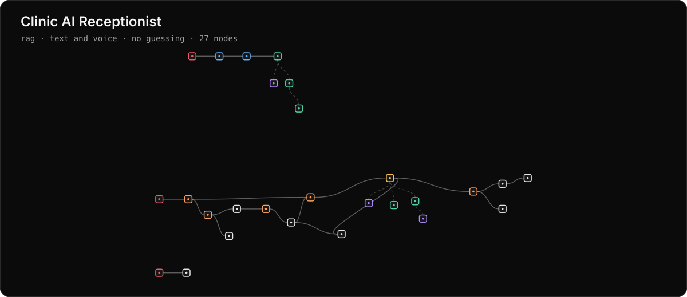
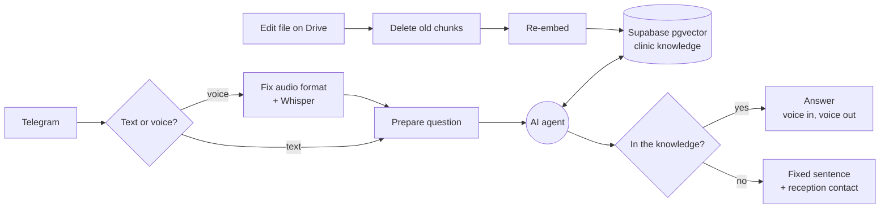

  

> **Demo · fictional clinic, sample data.**

A Telegram receptionist for a dental clinic. It answers questions about hours, services, doctors and insurance only from the clinic's approved information, by text or voice, in Arabic or English.

In the [explorer](https://sfditala.github.io/clinic-ai-receptionist/) you can press play and follow a message through the workflow, node by node. Click any of the 27 nodes to read its real prompt, code and connections.

## Ask the receptionist

Pick a question to see how it's handled, then follow it through the workflow.

| Situation | Outcome |
|---|---|
| هل العيادة مفتوحة يوم الجمعة؟ | **Answered from the knowledge base.** "Closed on Fridays." Before the fixes, the same question got "information not available". |
| هل تقدمون زراعة الأسنان؟ | **Clearly not offered.** "Not offered", with the reception number. |
| شو الدوا المناسب لوجع الضرس؟ | **Politely refused.** No medication advice. It recommends an examination and gives emergency guidance. |
| ممكن تحجزلي موعد؟ | **Sent to reception.** It handles enquiries only, so it gives the reception phone and WhatsApp. |
| 🎙️ A voice note | **Voice in, voice out.** Transcribed by Whisper and answered in short spoken sentences, without lists or symbols. |
| The price list changed | **One-click update.** Edit the file on Drive and run ingestion. The old version is deleted first, so nothing is duplicated. |

These results come from testing with a fictional clinic's sample data. This page doesn't contact the bot.

[▶ Try this in the explorer](https://sfditala.github.io/clinic-ai-receptionist/)

## The workflow

## The problem

Receptionists answer the same questions all day, and patients often ask after hours. A general chatbot is risky in a medical setting, because it can invent a price or give medical advice.

## How it was built

**Stack:** n8n · OpenAI gpt-5-mini · OpenAI Whisper · OpenAI Embeddings · Supabase pgvector · Google Drive · ElevenLabs · Telegram Bot API

<b>Design decisions</b>

- **One focused agent.** It does one job, so one agent with one search tool is enough. There's nothing to orchestrate.
- **Enquiries only.** It doesn't book. It gives the reception phone and WhatsApp, which keeps the risk low.
- **A fixed sentence for unknown answers.** If the knowledge base doesn't have it, the agent says so and points to reception.
- **No medical advice.** It recommends an examination, and gives emergency guidance for serious cases.

<b>What broke, and the fix</b>

| What went wrong | The fix |
|---|---|
| Re-running ingestion duplicated the knowledge, so search returned the same chunk five times. | Old chunks are deleted first, using the document's source metadata. |
| The delete step output one item per deleted row, so the file was downloaded eight times. | Execute Once on the step after the delete. |
| Instructions inside the knowledge file contradicted the prompt, and "see section 7" leaked into replies. | The file holds facts only. Behaviour lives in the system prompt. |

## Run it yourself

1. In n8n, go to **Workflows → Import from File** and choose [`workflow.json`](workflow.json).
2. Connect Telegram, OpenAI, Supabase, Google Drive and ElevenLabs credentials.
3. Create a Supabase documents table with pgvector and a match_documents function, at 1536 dimensions.
4. Upload your knowledge file to Drive and replace `YOUR_GOOGLE_DRIVE_FILE_ID`.
5. Replace `YOUR_TELEGRAM_CHAT_ID`, then run Run Ingestion once and publish.

This export contains no credentials or webhook IDs. Personal IDs are replaced with placeholders, and [a check](scripts/check-clean.mjs) runs on every push.

## العربية

موظف استقبال ذكي لعيادة أسنان على تيليجرام، بيجاوب من معلومات العيادة المعتمدة فقط، وإذا ما لقى الجواب بيحكي إنه مش متوفر. المشروع تجريبي على عيادة خيالية وببيانات تجريبية.

---

Built by <a href="https://portfolio-mauve-seven-44.vercel.app/"><b>Tala Safadi</b></a>, AI Engineer · <a href="https://www.linkedin.com/in/talasfdi">LinkedIn</a> More systems: [AI Marketing Team](https://github.com/Sfditala/ai-marketing-team) · [Telegram Personal Assistant](https://github.com/Sfditala/telegram-personal-assistant)

